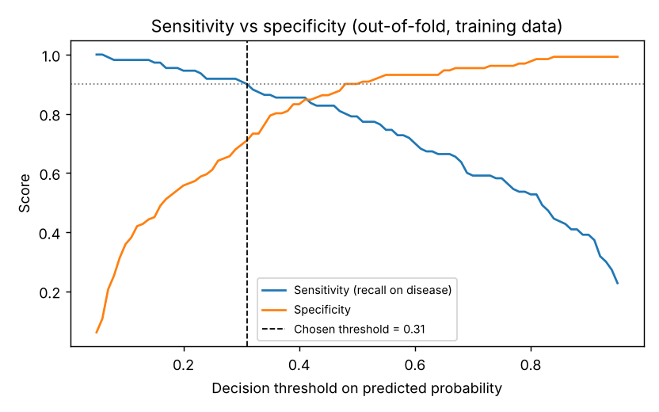
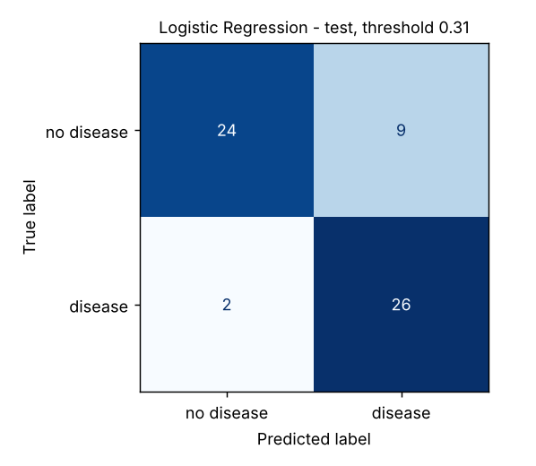

# Heart Disease Prediction: an end-to-end ML project

An educational, fully reproducible machine learning project: from raw data audit to a deployed
Streamlit interface. It predicts the heart disease label in the
[Kaggle heart disease dataset](https://www.kaggle.com/datasets/johnsmith88/heart-disease-dataset)
(a copy of the UCI Cleveland data) with a focus on **honest evaluation** and **sensitivity to
disease cases**.

> ⚠️ **Not a medical tool.** The model reproduces labels from a small 1980s research dataset.
> Its outputs are not diagnoses and must not be used for medical decisions.

## Results at a glance

| | Value |
|---|---|
| Raw rows → unique patients | 1,025 → **302** (723 exact duplicates removed) |
| Selected model | **L1-regularised logistic regression** |
| Decision threshold | **0.31** (chosen on training data for ≥ 90% sensitivity) |
| Test ROC-AUC | **0.90** |
| Test sensitivity / specificity | **0.93 / 0.73** (missed 2 of 28 disease cases) |
| Same model at the default 0.5 threshold | sensitivity 0.75 / specificity 0.85 (missed 7 of 28) |

<p align="center">
  
  
</p>

The test set holds 61 patients, so these numbers have wide uncertainty (roughly ±0.1).
Cross-validation results in `reports/cv_results.csv` give a more stable picture.

## Three findings that shape the project

1. **70% of the rows are duplicates.** Only 302 of 1,025 rows are unique. Splitting without
   de-duplicating puts copies of the same patient in train *and* test, which is why many public
   notebooks report 98–100% accuracy on this data. All analysis here uses unique rows only, and a
   test (`test_no_patient_in_both_train_and_test`) guards against leakage.
2. **The `target` column is inverted relative to its documentation.** Rows with `target = 1` have
   the *healthier* clinical profile: higher max heart rate, less ST depression, less exercise
   angina, fewer diseased vessels ([figure](reports/figures/00_label_direction.png)). The project
   models `has_disease = 1 − target` so that "positive" really means disease. After the flip, the
   138 disease cases match the original UCI count, and every correlation has its clinically
   expected sign. The switch is one line in `src/heart/config.py` (`INVERT_TARGET`).
3. **Invalid codes are treated as missing values, not as categories.** `ca = 4` (4 rows) and
   `thal = 0` (2 rows) are not valid values in the source data. They are set to missing and
   imputed inside the pipeline.

## Method

```
raw CSV ─► validate schema ─► drop duplicates ─► invalid codes → NaN ─► label = 1 − target
        ─► stratified 80/20 split (test set locked away)
        ─► [train only] 5×5 repeated stratified CV: baseline + 6 models, untuned vs tuned (GridSearchCV)
        ─► select by CV ROC-AUC (within 1 SE of best → prefer the simpler model)
        ─► choose threshold on out-of-fold train predictions (sensitivity ≥ 0.90)
        ─► evaluate ONCE on the test set ─► interpret ─► save pipeline + threshold ─► Streamlit app
```

All preprocessing (imputation, scaling, one-hot encoding) lives inside a scikit-learn `Pipeline`,
so it is re-fitted on each training fold and never sees validation or test data.

| Model | CV ROC-AUC untuned | CV ROC-AUC tuned |
|---|---|---|
| Baseline (majority class) | 0.500 | — |
| Logistic Regression | 0.909 | 0.911 |
| K-Nearest Neighbors | 0.877 | 0.910 |
| Decision Tree | 0.753 | 0.858 |
| Random Forest | 0.910 | **0.918** |
| SVM (RBF) | 0.906 | 0.913 |
| Gradient Boosting | 0.889 | 0.910 |

Random Forest had the highest CV ROC-AUC, but logistic regression was within one standard error
(0.007). With differences that small, the simpler and fully interpretable model is the better
choice. The test-set scores of the other models are reported only for transparency
(`reports/test_results_all_models.csv`) and were **not** used to choose anything.

The most influential features (permutation importance and coefficients) are the number of
vessels coloured by fluoroscopy (`ca`), chest pain type `cp = 0`, thallium result `thal = 3`,
exercise-induced angina, sex and ST depression. See [`reports/interpretation.md`](reports/interpretation.md).

## Project structure

```
├── app/streamlit_app.py        # prediction interface
├── notebooks/
│   └── heart_disease_end_to_end.ipynb  # full walkthrough with outputs, stage by stage
├── data/raw/heart.csv          # original Kaggle file (never modified)
├── docs/
│   ├── walkthrough.md          # every stage explained, with interview questions
│   └── model_card.md           # intended use, performance, limitations
├── models/
│   ├── heart_disease_model.joblib  # fitted pipeline + threshold + metadata
│   └── split.joblib                # the exact train/test split used
├── reports/
│   ├── data_profile.md  interpretation.md  metrics.json
│   ├── cv_results.csv  feature_engineering_cv.csv  test_results_all_models.csv
│   └── figures/
├── src/heart/
│   ├── config.py     # paths, feature groups, constants
│   ├── data.py       # load, validate, clean, label, split
│   ├── features.py   # preprocessing pipeline + engineered feature
│   ├── models.py     # candidate models and search grids
│   ├── evaluate.py   # metrics (incl. specificity), threshold choice, plots
│   ├── eda.py        # exploratory analysis → figures + data profile
│   ├── train.py      # full training workflow
│   ├── interpret.py  # permutation importance, odds ratios, per-patient explanations
│   └── predict.py    # load model, score a record
└── tests/test_pipeline.py
```

## Notebook

[`notebooks/heart_disease_end_to_end.ipynb`](notebooks/heart_disease_end_to_end.ipynb) walks through all 12 stages with code, outputs, plots and the reasoning behind each decision. It imports the `src/heart` package, so the notebook and the scripts always use the same logic, and it checks that it reproduces the saved model exactly.

## Reproduce

```bash
python -m venv .venv && source .venv/bin/activate   # Windows: .venv\Scripts\activate
pip install -r requirements.txt
pip install -e .

python -m heart.eda         # figures + reports/data_profile.md
python -m heart.train       # CV, tuning, threshold, test evaluation, saves the model (~1-2 min)
python -m heart.interpret   # reports/interpretation.md
pytest                      # 14 tests
jupyter lab notebooks/      # optional: the walkthrough notebook
streamlit run app/streamlit_app.py
```

All randomness uses `random_state=42`, so re-running reproduces the same numbers.

## Limitations

- **Small sample:** 302 patients (241 train / 61 test), so every metric has wide confidence intervals.
- **Representativeness:** a 1980s referral population from a single study, 68% male. Performance
  for women, other populations and present-day patients is unknown.
- **Label quality:** the source's label coding is inconsistent (see finding 2), and the
  category codes for `cp`, `thal`, `slope` and `restecg` are documented differently across sources.
- **Association, not causation:** feature importance describes what the model uses, not what
  causes disease.
- **No external validation:** a real clinical model would need testing on independent hospitals' data.

See [`docs/model_card.md`](docs/model_card.md) for details.

## License

MIT. The dataset is from Kaggle / the UCI Machine Learning Repository; see their terms.
